---

## About

I am a **SecOps Security Engineer Intern at the New Jersey Office of Homeland Security & Preparedness (NJCCIC)**, where I run exposure management and attack surface monitoring with **CrowdStrike** and roll out security benchmarks across **all 45 New Jersey government agencies**.

Graduating **December 2026** from **Rowan University** with a **B.S. in Computing & Informatics** and a **minor in Cybersecurity** (3.8 GPA). Previously an **Information Security Analyst** at Rowan's IRT Office and a **2026 Cybersecurity Research Fellow** at Carnegie Mellon University's Heinz College.

I build and automate the tooling that moves a finding from raw data to defensible, prioritized action.

---

## Focus

<table>
  <tr>
    <td width="33%" valign="top">
      <b>Security Operations</b> 
      SIEM detection, threat hunting, and log analysis across enterprise environments.
    </td>
    <td width="33%" valign="top">
      <b>Vulnerability Research</b> 
      From candidate finding to evidence backed, CVSS scored, defensible disclosure.
    </td>
    <td width="33%" valign="top">
      <b>Automation &amp; Tooling</b> 
      Python and API driven workflows that cut analyst reporting time by up to 75 percent.
    </td>
  </tr>
</table>

---

## Featured Work

<table>
  <tr>
    <td width="53%">
      
    </td>
    <td width="47%" valign="top">
      <h3>KinetixZero</h3>
      <b>Vulnerability research and responsible-disclosure platform</b>
      
Takes an authorized target, finds candidate vulnerabilities in its code and dependencies, and walks a researcher from "potential" to a defensible finding, every step recorded in a tamper evident chain of custody.

      <ul>
        <li>28 rule Semgrep pack with OSV dependency matching and secret detection</li>
        <li>Taint based confidence ranking, hash chained audit log, Postgres row level security</li>
        <li>CVSS 4.0, TOTP, coordinated disclosure, exports to PDF, CVE 5.1, and OSV</li>
        <li>Passed an independent penetration test with no critical, high, or medium findings</li>
      </ul>
      
    </td>
  </tr>
</table>

<table>
  <tr>
    <td width="47%" valign="top">
      <h3>ResumePass</h3>
      <b>ATS resume tailoring and interview prep, live at resumepass.me</b>
      
Scores a job posting against your real experience, drafts resume bullets in the posting's own wording without inventing anything, and generates eight STAR method interview stories. Everything runs in the browser.

      <ul>
        <li>ATS match scoring with clear verdict bands and a cumulative gap report</li>
        <li>Application tracker with per job briefs, CSV export, and a mock interviewer</li>
        <li>Zero setup hosted AI through a Cloudflare Worker, bring your own key optional</li>
      </ul>
      
      
    </td>
    <td width="53%">
      
    </td>
  </tr>
</table>

---

## Published Research

> Two peer reviewed papers published on **Carnegie Mellon University KiltHub**, September 2026.

<table>
  <tr>
    <td width="50%" valign="top">
      <code>PEER-REVIEWED &#183; CMU KILTHUB &#183; 2026</code>
      <h3>Solved Math, Unsolved Migration</h3>
      <b>A Risk-Based Framework for Post-Quantum Cybersecurity</b>
      
Sole author. A practical framework for prioritizing the migration to post-quantum cryptography by risk rather than by cryptographic theory alone.

    </td>
    <td width="50%" valign="top">
      <code>PEER-REVIEWED &#183; CMU KILTHUB &#183; 2026</code>
      <h3>AI for Cyber Defenders</h3>
      <b>How Cyber Defenders Can Leverage Artificial Intelligence To Defend Against Cyber Attacks</b>
      
Co-author. How defensive teams can apply AI across detection, triage, and response to tilt the advantage back toward the defender.

    </td>
  </tr>
</table>

---

## Tech Arsenal

**Security Operations & Detection**

  
  
  
  

**Vulnerability & Offensive**

  
  
  
  
  

**Scripting & Systems**

  
  
  
  
  
  

**Frameworks & Compliance**

  
  
  
  
  

---

<i>Building secure systems, one vulnerability at a time.</i>

  

